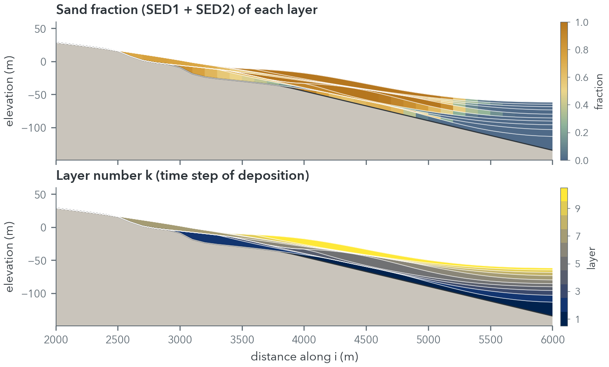
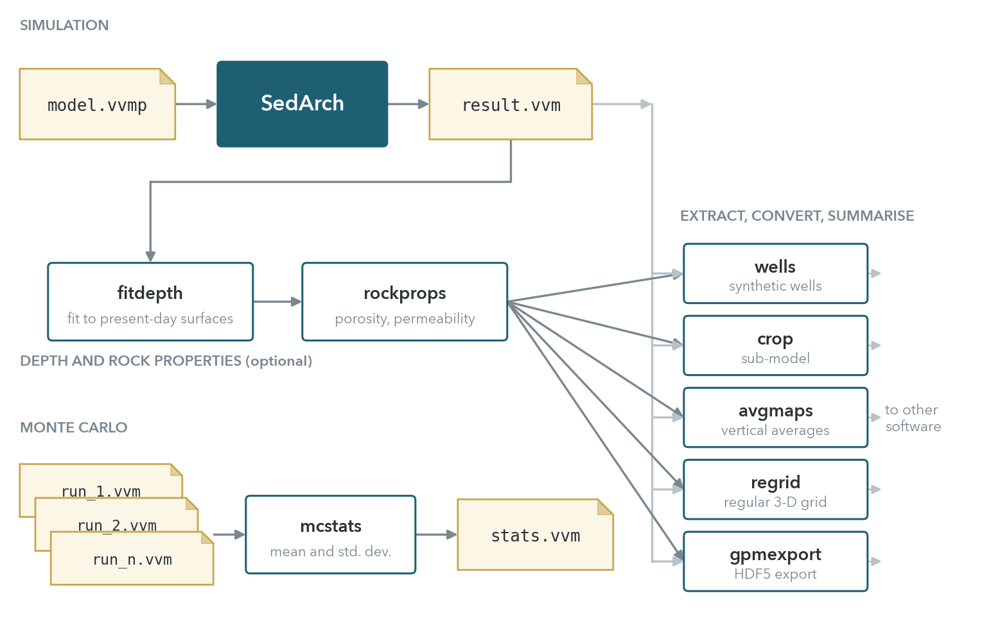

# SedCompanion — companion tools for SedArch models

SedCompanion is a set of command-line tools for working with **SedArch** models
(`.vvm` result files and `.vvmp` parameter files). It places a model at its
present-day depth, adds porosity and permeability, extracts wells and sub-models,
computes averages and Monte Carlo statistics, and converts models to formats used
by other geological and geostatistical software.

The full description of every tool, with figures and equations, is in the
**[User Guide (PDF)](sedCompanion/SedCompanion_userdoc.pdf)**.



## The tools

| Tool | What it does | Writes |
|------|--------------|--------|
| `fitdepth`  | Fits a model to present-day base, top or isopach surfaces and optionally adds an overburden | vvm model |
| `rockprops` | Adds layer thickness, depth of deposition, burial, porosity and permeability | vvm model |
| `wells`     | Extracts synthetic vertical wells at given X–Y locations | xyz text |
| `crop`      | Cuts out a rectangular part of a model, optionally a range of layers | vvm model |
| `avgmaps`   | Thickness-weighted vertical averages over a range of layers | vvm maps |
| `regrid`    | Resamples one property onto a regular 3-D grid of equal cells | plain / vvm / GSLIB grid |
| `gpmexport` | Converts a model to an HDF5 file in the Petrel-GPM layout | HDF5 |
| `mcstats`   | Combines many model runs into mean and standard-deviation models | vvm model |



## Requirements

- Python 3.9 or later
- NumPy
- h5py (only for `gpmexport`)

```bash
pip install numpy h5py
```

No installation step is needed: run the tools from the folder that contains
`sedCompanion/` (the root of this repository), or add that folder to `PYTHONPATH`.

## Usage

```bash
python3 -m sedCompanion <tool> <arguments ...>
```

Running `python3 -m sedCompanion` without a tool name lists the tools; running a
tool with the wrong number of arguments prints its help. Text output uses CR LF
line endings by default; put `--lf` before the tool name for Unix line endings.

| Command | Arguments |
|---------|-----------|
| `fitdepth`  | `model.vvm surfaces1.vvm [surfaces2.vvm] result.vvm` |
| `rockprops` | `model.vvm parameters.vvmp result.vvm` |
| `wells`     | `model.vvm wells.vvmp result.xyz` |
| `crop`      | `model.vvm result.vvm [xmin xmax ymin ymax [zmin zmax]]` |
| `avgmaps`   | `model.vvm result.vvm [m n]` |
| `regrid`    | `model.vvm parameters.vvmp result.txt` |
| `gpmexport` | `model.vvm result.hdf5` |
| `mcstats`   | `stats.vvm run1.vvm [run2.vvm ...]` |

## Quick start with the example model

`sedCompanion/input/` holds a small SedArch result (`dispersion_out.vvm`,
61 × 41 nodes, 11 time steps) and a parameter file for each tool. From inside
`sedCompanion/`:

```bash
export PYTHONPATH="$PWD/.."
mkdir -p work
python3 -m sedCompanion fitdepth  input/dispersion_out.vvm input/fitdepth_parm.vvm   work/depth.vvm
python3 -m sedCompanion rockprops input/dispersion_out.vvm input/rockprops_parm.vvmp work/post.vvm
python3 -m sedCompanion wells     input/dispersion_out.vvm input/wells_parm.vvmp     work/wells.xyz
python3 -m sedCompanion crop      input/dispersion_out.vvm work/part.vvm 10 30 10 30
python3 -m sedCompanion avgmaps   input/dispersion_out.vvm work/average.vvm 2 8
python3 -m sedCompanion regrid    input/dispersion_out.vvm input/regrid_parm.vvmp    work/grid.txt
python3 -m sedCompanion gpmexport input/dispersion_out.vvm work/model.hdf5
python3 -m sedCompanion mcstats   work/stats.vvm input/dispersion_out.vvm
```

## Testing

`verify.py` runs every tool on the example inputs and compares the results with
the reference outputs in `sedCompanion/output/`. From the repository root:

```bash
python3 -m sedCompanion.verify sedCompanion
```

## Repository layout

```
sedCompanion/
├── __main__.py            command-line dispatcher
├── vvm.py, model.py       vvm/vvmp reader and writer, model structure
├── fitdepth.py … mcstats.py   one module per tool
├── verify.py              regression test
├── input/                 example model and parameter files
├── output/                reference results for the example
├── docs_src/figures/      figures used in this README and the guide
└── SedCompanion_userdoc.pdf
```

## License

GNU General Public License v3.0 — see [LICENSE](LICENSE).
